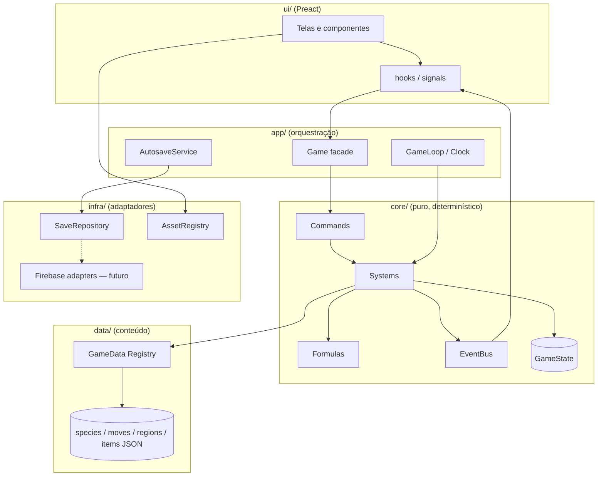

# Pokémon Idle — Arquitetura Técnica

> Versão 0.1 — proposta para revisão. Complementa o [GDD](./GDD.md).

---

## 1. Decisões de stack

| Camada | Escolha | Por quê |
|---|---|---|
| Linguagem | **TypeScript (strict)** | Centenas de espécies e dezenas de sistemas exigem tipagem forte; refatorações seguras |
| Build / dev server | **Vite** | Rápido, zero-config, gera estático (deploy em Vercel/Netlify/Firebase Hosting) |
| UI | **Preact + @preact/signals** | API do React em 4 kB; signals atualizam só o que muda, ideal para contadores que mudam a cada tick |
| Estilo | **CSS Modules + variáveis CSS** | Simples; temas e cores por tipo via tokens |
| Validação de dados | **Zod** | Valida o banco de dados de conteúdo e o save carregado (proteção contra save corrompido) |
| Testes | **Vitest** | Mesmo pipeline do Vite; testes das fórmulas e dos sistemas com RNG semeado |
| Persistência local | **IndexedDB** (via `idb-keyval`) com fallback para `localStorage` | Saves grandes (PC com milhares de Pokémon) passam de 5 MB |
| Nuvem (futuro) | **Firebase** (Auth, Firestore, Cloud Functions, Hosting) | Pedido do projeto; atrás de interfaces desde o dia 1 |
| Qualidade | ESLint + Prettier | Padrão |

**Sem motor de jogo** (Phaser/Pixi): a cena de batalha é simples (2 sprites, barras, efeitos) e se resolve com DOM/CSS ou
um `<canvas>` pequeno. Isso mantém o bundle leve e a UI acessível. Se no futuro houver um mapa animado, um módulo de
canvas pode ser adicionado sem tocar no core.

---

## 2. Princípios

1. **Core puro.** `src/core` não importa nada de DOM, navegador, Preact ou Firebase. Ele roda igual no navegador, em
   testes e no simulador headless (Node).
2. **Dados ≠ lógica ≠ interface.** O conteúdo (espécies, rotas, itens) é dado declarativo validado; a lógica são
   sistemas; a UI só lê estado e envia comandos.
3. **Estado único e serializável.** Todo o progresso do jogador é um objeto JSON (`GameState`). Salvar = serializar.
4. **Simulação determinística.** Toda aleatoriedade passa por um RNG semeado (`state.rng`). Mesmo estado + mesmos
   comandos = mesmo resultado. Isso habilita testes reproduzíveis, replay e, no futuro, validação de ranking no servidor.
5. **Comunicação por eventos.** Sistemas emitem eventos de domínio (`PokemonCaptured`, `LevelUp`…); Pokédex, conquistas,
   log e UI reagem sem acoplamento direto.
6. **Interfaces nas bordas.** Persistência, relógio, assets e serviços remotos são interfaces com implementações
   trocáveis (Local ↔ Firebase, relógio real ↔ relógio falso de teste).

---

## 3. Visão em camadas



**Regra de dependência:** as setas só apontam "para dentro". `ui → app → core → data`. `core` nunca importa `app`, `ui`
ou `infra`.

---

## 4. Estrutura de pastas

```
/ (raiz do repositório)
├── docs/                         # GDD, arquitetura, roadmap, decisões (ADRs)
├── public/
│   └── assets/
│       ├── sprites/
│       │   ├── pokemon/{front,back,front-shiny,back-shiny,icons}/{id}[-{form}].png
│       │   ├── items/{itemId}.png
│       │   ├── trainers/{trainerClass}.png
│       │   └── ui/
│       └── manifest.json         # gerado: quais sprites existem (para fallback)
├── scripts/
│   ├── build-data/               # pipeline: fontes → JSON validado do jogo
│   ├── build-sprite-manifest.ts
│   └── sim/                      # simulador headless de balanceamento
├── src/
│   ├── core/
│   │   ├── engine/               # rng.ts, eventBus.ts, scheduler.ts, time.ts
│   │   ├── state/                # GameState types, createInitialState, selectors
│   │   ├── formulas/             # stats, experience, damage, capture, typeChart, economy
│   │   ├── systems/
│   │   │   ├── exploration/      # cronômetro de encontros, sorteio da tabela
│   │   │   ├── battle/           # BattleState, turnos, IA de golpe
│   │   │   ├── capture/          # regras de captura + chance
│   │   │   ├── progression/      # XP, level up, teto, EVs, amizade
│   │   │   ├── evolution/        # avaliador de condições
│   │   │   ├── pokedex/
│   │   │   ├── inventory/
│   │   │   ├── economy/          # loja, melhorias, transferências
│   │   │   ├── regions/          # desbloqueios, ginásios, liga
│   │   │   ├── offline/          # simulação agregada de tempo offline
│   │   │   └── achievements/     # (fase futura)
│   │   ├── commands/             # ações do jogador (selectArea, buyItem, useItem, setParty…)
│   │   ├── events.ts             # union tipada de eventos de domínio
│   │   └── tick.ts               # tick(state, dt, ctx) → orquestra sistemas
│   ├── data/
│   │   ├── schema/               # Zod: Species, Move, Area, Item, Trainer…
│   │   ├── generated/            # species.json, moves.json, learnsets.json (NÃO editar à mão)
│   │   ├── content/              # conteúdo autoral: regions/kanto/*.ts, items.ts, upgrades.ts, shop.ts
│   │   ├── i18n/                 # pt-BR.json, en.json (nomes de UI; nomes de espécies vêm do generated)
│   │   └── registry.ts           # carrega, valida e indexa (Map por id), exposto como GameData
│   ├── infra/
│   │   ├── persistence/          # SaveRepository, IndexedDbRepository, LocalStorageRepository, migrations/
│   │   ├── assets/               # AssetRegistry (resolve caminho, fallback, preload)
│   │   ├── clock/                # SystemClock, (futuro) ServerClock
│   │   └── firebase/             # (futuro) auth, cloudSave, leaderboard
│   ├── app/
│   │   ├── Game.ts               # facade: estado + loop + eventos + comandos
│   │   ├── GameLoop.ts           # rAF/setInterval, acumulador de tempo fixo
│   │   └── AutosaveService.ts
│   ├── ui/
│   │   ├── App.tsx, router.ts
│   │   ├── screens/              # Explore, Map, Party, PC, Pokedex, Bag, Shop, Lab, CaptureRules, Settings
│   │   ├── components/           # Sprite, HpBar, TypeBadge, Window, PokemonCard, Modal…
│   │   ├── hooks/                # useGameSignal, useSelector
│   │   └── styles/               # tokens.css, pixel.css
│   └── main.tsx
├── tests/                        # espelha src/core (unit) + cenários de integração
├── index.html
├── package.json, tsconfig.json, vite.config.ts
```

---

## 5. Modelo de dados — conteúdo (estático)

Conteúdo **gerado** (fatos numéricos, via script) + conteúdo **autoral** (design de rotas, itens, preços). Tudo validado por
Zod no build e indexado por id na carga.

```ts
type TypeId = 'normal' | 'fire' | 'water' | 'grass' | 'electric' | 'ice' | 'fighting' | 'poison' | 'ground'
            | 'flying' | 'psychic' | 'bug' | 'rock' | 'ghost' | 'dragon' | 'dark' | 'steel' | 'fairy';

type StatKey = 'hp' | 'atk' | 'def' | 'spa' | 'spd' | 'spe';
type Stats = Record<StatKey, number>;

interface Species {
  id: number;                    // nº Nacional (1..1025)
  key: string;                   // 'bulbasaur' — id estável para saves e assets
  form?: string;                 // 'alola', 'galar'… (espécie+forma = entrada distinta)
  names: Record<Locale, string>;
  types: [TypeId] | [TypeId, TypeId];
  baseStats: Stats;
  growthRate: 'fast' | 'medium-fast' | 'medium-slow' | 'slow' | 'erratic' | 'fluctuating';
  captureRate: number;           // 3..255
  baseExp: number;
  evYield: Partial<Stats>;
  genderRatio: number | null;    // % fêmea, null = sem gênero
  generation: number;
  evolutionLineId: string;       // agrupa Afinidade
  evolutions: Evolution[];
  learnset: { level: number; moveId: string }[];   // só level-up na v1
  tags: ('legendary' | 'mythical' | 'baby' | 'starter' | 'fossil')[];
}

interface Evolution {
  into: string;                          // species key
  conditions: EvolutionCondition[];      // TODAS precisam ser verdadeiras
}

type EvolutionCondition =
  | { type: 'level'; min: number }
  | { type: 'item'; itemId: string }              // uso manual de item
  | { type: 'heldItem'; itemId: string }
  | { type: 'friendship'; min: number }
  | { type: 'timeOfDay'; value: 'morning' | 'day' | 'night' }
  | { type: 'area'; tag: string }                  // ex. 'mossy-rock'
  | { type: 'knowsMove'; moveId: string }
  | { type: 'statCompare'; rule: 'atk>def' | 'atk<def' | 'atk=def' }
  | { type: 'gender'; value: 'male' | 'female' }
  | { type: 'personality'; bucket: number; of: number }
  | { type: 'custom'; id: string };                // gancho em código

interface Move {
  id: string; names: Record<Locale, string>;
  type: TypeId; category: 'physical' | 'special' | 'status';
  power: number | null; accuracy: number | null; priority: number;
}

interface Region { id: string; order: number; names: Record<Locale,string>; levelCaps: number[]; tier: number;
                   unlock: Requirement[]; areas: string[]; }

interface Area {
  id: string; regionId: string; names: Record<Locale,string>;
  kind: 'route' | 'cave' | 'forest' | 'water' | 'gym' | 'league' | 'special';
  tags: string[];                               // 'mossy-rock', 'ice-rock', 'safari'…
  unlock: Requirement[];
  encounters: EncounterSlot[];
  trainers: TrainerRef[];
  gym?: GymDef;
  winsToClear: number;
}

interface EncounterSlot { species: string; weight: number; minLevel: number; maxLevel: number;
                          timeOfDay?: TimeOfDay[]; requires?: Requirement[]; method?: 'walk' | 'fish' | 'surf'; }

type Requirement =
  | { type: 'areaCleared'; areaId: string }
  | { type: 'badge'; badgeId: string }
  | { type: 'badgeCount'; regionId: string; min: number }
  | { type: 'championOf'; regionId: string }
  | { type: 'pokedexCaught'; min: number; regionId?: string }
  | { type: 'keyItem'; itemId: string };

interface Item { id: string; category: ItemCategory; price: number | null; sellPrice: number | null;
                 effect: ItemEffect; }                   // ItemEffect = union discriminada (ball, heal, evolve, boost…)
```

**Escala:** 1.025 espécies × ~1 KB ≈ 1 MB de JSON (≈ 200 KB gzip). Os dados são divididos **por geração** e carregados
sob demanda (`import()` dinâmico) conforme as regiões são liberadas; os índices em `Map<string, Species>` dão acesso O(1).

### 5.1 Pipeline de dados (`scripts/build-data`)
1. Lê as fontes de dados factuais da comunidade (CSVs do projeto PokeAPI — espécies, atributos, tipos, learnsets,
   cadeias de evolução, nomes em PT/EN).
2. Normaliza para os tipos acima, aplica **overrides** manuais (`content/overrides.ts`, ex.: troca → Cabo de Ligação).
3. Valida com Zod e grava `src/data/generated/gen{N}.json`.
4. É reprodutível, versionado e roda com `npm run build:data`. Ninguém edita o JSON gerado à mão.

---

## 6. Modelo de dados — estado do jogador (save)

```ts
interface GameState {
  meta: { saveVersion: number; createdAt: number; lastTickAt: number; lastSavedAt: number;
          revision: number; playTimeMs: number; playerId?: string };
  rng: { seed: number; state: number };            // xoshiro128** / mulberry32
  player: { name: string; money: number; researchPoints: number; badges: string[];
            champions: string[]; settings: PlayerSettings };
  party: PokemonUid[];                             // até 6
  pokemon: Record<PokemonUid, OwnedPokemon>;      // todos os capturados (equipe + PC)
  pc: { boxes: PokemonUid[][]; capacity: number };
  pokedex: Record<string /*speciesKey*/, { seen: number; caught: number; shiny: boolean; firstCaughtAt?: number }>;
  affinity: Record<string /*evolutionLineId*/, { points: number; level: number }>;
  inventory: Record<string /*itemId*/, number>;
  upgrades: Record<string /*upgradeId*/, number>;
  research: { claimedMilestones: string[] };
  world: {
    activeAreaId: string;
    areas: Record<string, { wins: number; trainersDefeated: string[]; cleared: boolean; mastered: boolean }>;
  };
  exploration: { phase: 'walking' | 'battle' | 'capture' | 'healing'; timerMs: number; battle?: BattleState;
                 lossStreak: number };
  captureRules: CaptureRule[];
  boosts: { id: string; expiresAtPlayMs: number }[];
  stats: Record<string, number>;                  // contadores (batalhas, capturas, shinies...) → conquistas/ranking
  log: LogEntry[];                                // buffer circular (últimos 100), não essencial
}

interface OwnedPokemon {
  uid: string; species: string; form?: string; nickname?: string;
  level: number; xp: number; ivs: Stats; evs: Stats; nature: NatureId;
  gender: 'm' | 'f' | null; shiny: boolean; personality: number;  // personality → evoluções aleatórias
  friendship: number; heldItem?: string; moves: string[]; currentHp: number;
  caughtAt: number; caughtArea: string; ball: string; locked?: boolean; evolutionLock?: boolean;
}
```

- **Atributos finais não são salvos**: são derivados (`selectors/stats.ts`) e memoizados por `uid + level + species + affinity`.
- **Saves grandes:** com mais de ~20 mil Pokémon, o PC pode migrar para um formato compacto (tuplas) sem mudar a API
  (só o serializer muda).

---

## 7. Motor: loop, tick e eventos

### 7.1 Passo fixo
```ts
const STEP_MS = 100;                 // 10 ticks lógicos por segundo

function frame(nowMs) {
  acc += clamp(nowMs - last, 0, MAX_CATCHUP_MS);   // evita "espiral da morte"
  while (acc >= STEP_MS) { tick(state, STEP_MS, ctx); acc -= STEP_MS; }
  ui.flush();                          // atualiza signals no máx. 1x por frame
}
```
- Em primeiro plano: `requestAnimationFrame`.
- Em segundo plano (aba oculta), o navegador limita timers a ~1 Hz: o loop passa para `setInterval(1000)` e o acumulador
  processa vários ticks por chamada.
- Se a aba ficar oculta por mais de 60 s (ou o jogo for fechado), o caminho passa a ser o **Offline** (§8), e não o
  catch-up tick a tick.

### 7.2 `tick()` — ordem dos sistemas
```
tick(state, dt, ctx):
  boosts.update        → expira boosts
  exploration.update   → avança o cronômetro; ao zerar, gera encontro → inicia battle
  battle.update        → processa ações cujo tempo chegou; ao terminar emite BattleWon/BattleLost
  capture.update       → (fase capture) aplica regras, consome bola, sorteia, emite PokemonCaptured/CaptureFailed
  healing.update       → Centro Pokémon
  // reações a eventos (síncronas, na mesma ordem em que foram emitidos):
  progression  ← BattleWon            → XP, EVs, amizade, LevelUp
  evolution    ← LevelUp              → EvolutionTriggered
  pokedex      ← EncounterStarted / PokemonCaptured / Evolved
  affinity     ← PokemonCaptured
  regions      ← BattleWon (gym/trainer) → BadgeEarned, AreaUnlocked
  economy      ← BattleWon            → dinheiro, drops
  log/ui       ← tudo
```
Cada sistema é um módulo `{ update?(state, dt, ctx), on?: { [EventType]: handler } }`. O `ctx` injeta `data` (GameData),
`rng`, `clock` e `emit`. Os sistemas podem ser testados isoladamente com estado e RNG falsos.

### 7.3 Comandos (entrada do jogador)
A UI **nunca** altera o estado diretamente:
```ts
game.dispatch({ type: 'SelectArea', areaId: 'kanto-route-2' });
game.dispatch({ type: 'BuyItem', itemId: 'great-ball', qty: 10 });
game.dispatch({ type: 'UseItem', itemId: 'thunder-stone', targetUid });
game.dispatch({ type: 'SetParty', uids: [...] });
```
O comando é validado (pode? tem dinheiro? requisito?) e aplicado entre ticks. O retorno é `Result<ok | erro legível>`.
Em fase futura, o mesmo log de comandos + seed permite **replay** para validação de ranking.

### 7.4 Eventos de domínio (exemplos)
`EncounterStarted`, `BattleStarted`, `MoveUsed`, `PokemonFainted`, `BattleWon`, `BattleLost`, `CaptureAttempted`,
`PokemonCaptured`, `CaptureFailed`, `XpGained`, `LevelUp`, `Evolved`, `ItemFound`, `ItemUsed`, `MoneyChanged`,
`BadgeEarned`, `AreaUnlocked`, `RegionUnlocked`, `MilestoneReached`, `ShinyEncountered`.

---

## 8. Progresso offline

Simular tick a tick por 12 horas (430 mil ticks e ~10 mil batalhas) é lento demais no carregamento. Por isso o offline
usa **simulação agregada por blocos**:

1. `elapsed = min(now − lastTickAt, limiteOffline)`, e `efetivo = elapsed · eficiênciaOffline`.
2. **Amostragem de batalha:** com a equipe e a área atuais, roda **N = 30 batalhas reais** (mesmo código do jogo, RNG
   semeado) para medir: taxa de vitória, duração média, HP perdido por batalha, XP e ₽ por vitória.
3. Divide o tempo efetivo em **blocos** (ex.: 10 min de jogo). Em cada bloco:
   - `encontros = blocoMs / (intervaloEncontro + duraçãoMédiaBatalha)`
   - sorteia as espécies encontradas (multinomial sobre a tabela da área) → Pokédex "visto"
   - aplica as **regras de captura** a cada encontro vencido usando a fórmula de chance real → consome bolas (para quando
     elas acabam, salvo se houver comprador automático e ₽)
   - aplica XP/EVs/₽ → processa level ups e evoluções por nível **ao fim de cada bloco** (o poder cresce durante o
     offline)
   - se a taxa de vitória for baixa, aplica as regras de derrota (Centro Pokémon / recuo)
   - a cada 3 blocos, refaz a amostragem de batalha (a equipe pode ter ficado mais forte)
4. Gera um **Relatório de Retorno**: tempo, batalhas, capturas (novas espécies em destaque), shinies, níveis, evoluções,
   ₽ ganho, bolas gastas.

É determinístico (seed), executa em < 200 ms para 24 h e roda num **Web Worker** se passar de 50 ms. O tempo vem de
`Clock`. No futuro, um `ServerClock` (timestamp do Firestore) limita a manipulação do relógio do sistema.

---

## 9. Simulador headless (balanceamento)

`npm run sim -- --hours 48 --strategy greedy` roda o **mesmo core** em Node, com um "bot" que toma decisões simples
(avança de rota quando a taxa de vitória > 90%, compra bolas, usa pedras). Ele gera CSV/relatório: tempo até cada
insígnia, curva de nível, ₽ acumulado, espécies capturadas. O objetivo é comparar com as **metas de ritmo** do GDD §9.4
e pegar regressões de balanceamento em CI.

---

## 10. Persistência

```ts
interface SaveRepository {
  load(slot: string): Promise<SaveEnvelope | null>;
  save(slot: string, env: SaveEnvelope): Promise<void>;
  list(): Promise<SaveMeta[]>;
  delete(slot: string): Promise<void>;
}

interface SaveEnvelope {
  saveVersion: number; savedAt: number; revision: number; checksum: string;
  payload: string;                  // JSON do GameState, comprimido (lz-string / CompressionStream)
}
```
- **Implementações:** `IndexedDbRepository` (padrão), `LocalStorageRepository` (fallback), `MemoryRepository` (testes) e,
  no futuro, `FirestoreRepository`.
- **Autosave:** a cada 30 s, em `visibilitychange → hidden`, em `pagehide` e após eventos importantes (insígnia, shiny,
  evolução).
- **Backups rotativos:** mantém os 3 últimos saves válidos. Se o save atual falhar no checksum ou na validação Zod,
  oferece restaurar o anterior.
- **Exportar/Importar:** string Base64 (copiar/colar) e download de arquivo `.pkidle`.
- **Migrações:** `migrations/{n}.ts` com `migrate(oldState): newState`, aplicadas em sequência de `saveVersion` até a
  atual. Toda mudança de formato do save exige uma migração e um teste com fixture.

---

## 11. Assets (sprites)

```ts
interface AssetRegistry {
  pokemon(speciesKey: string, opts: { view: 'front' | 'back' | 'icon'; shiny?: boolean; form?: string }): string;
  item(itemId: string): string;
  trainer(trainerClass: string): string;
  preload(urls: string[]): Promise<void>;
}
```
- **Convenção de pastas** (ver §4): `public/assets/sprites/pokemon/front/25.png`,
  `.../front-shiny/25.png`, `.../back/25.png`, `.../icons/25.png`, formas como `25-alola.png`.
- O `scripts/build-sprite-manifest.ts` lista o que existe. O registro usa o manifesto para escolher um **fallback**
  (normal no lugar do shiny ausente; frente no lugar das costas ausentes; silhueta "?" genérica). Assim o jogo funciona
  com sprites incompletos durante o desenvolvimento.
- Os **pacotes de sprites são trocáveis**: `assetPack` configurável (ex.: `gen5-anim`, `gen3`, `custom`) sem mudar
  código.
- Renderização: `` com `image-rendering: pixelated`, `width/height` em múltiplos inteiros, `loading="lazy"` em
  grades grandes (PC e Pokédex usam **virtualização** de lista).

---

## 12. UI

- **Leitura:** `Game` expõe `signals` derivados (dinheiro, equipe, batalha atual, log). Os componentes leem via
  `useSelector(selectFn)`, e o re-render só acontece quando o valor selecionado muda.
- **Escrita:** apenas `game.dispatch(command)`.
- **Throttling:** o core roda a 10 Hz, mas a UI faz um único `flush` por frame de animação. Telas pesadas (PC, Pokédex)
  só recalculam ao receber eventos relevantes, não a cada tick.
- **Acessibilidade:** contraste AA, foco visível, botões grandes no mobile, opção de reduzir animações
  (`prefers-reduced-motion`).
- **i18n:** chaves em `data/i18n`, idioma padrão pt-BR, e nomes de espécies/golpes em PT e EN vindos dos dados gerados.

---

## 13. Integração futura com Firebase

| Recurso | Uso |
|---|---|
| **Auth** | Login anônimo automático → vincular Google/e-mail depois (sem perder o save) |
| **Firestore** | `users/{uid}` (perfil), `users/{uid}/saves/{slot}` (envelope comprimido + metadados), `leaderboards/{season}/{metric}/{uid}` |
| **Cloud Functions** | Validar envios de ranking (limites de plausibilidade, replay por amostragem), fechar temporadas, `serverTime` |
| **Hosting** | Deploy do build estático |
| **Remote Config** (opcional) | Eventos e ajustes de balanceamento sem deploy |

**Sincronização:** local-first. O jogo sempre salva localmente; o `CloudSyncService` envia o envelope com debounce
(ex.: a cada 2 min e ao sair). Conflito: compara `revision` e `playTimeMs`; se divergirem (dois dispositivos), mostra
os dois saves com resumo e o jogador escolhe.

**Regras de segurança (esboço):** cada usuário lê e escreve apenas `users/{uid}/**`; leaderboards são somente leitura no
cliente e escritos apenas por Cloud Function.

**Ranking:** métricas derivadas de `state.stats` e da Pokédex (espécies capturadas, shinies, força da equipe, tempo até
o Campeão). O determinismo (seed + log de comandos) é o que torna a validação no servidor possível depois. Até lá, o
ranking é marcado como "não verificado".

---

## 14. Testes e qualidade

| Tipo | Cobertura |
|---|---|
| Unitários | Fórmulas (atributos, dano, captura, XP de todas as curvas), tabela de tipos, avaliador de evolução, requisitos |
| Sistemas | Batalha completa com RNG semeado, regras de captura, offline (24 h com resultados estáveis via snapshot) |
| Dados | Validação Zod de todo o conteúdo; integridade referencial (toda `species` de encontro existe, toda evolução aponta para espécie válida, todo item referenciado existe) |
| Saves | Migrações com fixtures de versões antigas; round-trip save → load |
| Balanceamento | Simulador headless com limites (ex.: "insígnia 1 em < 1 h de jogo simulado") |

O CI (GitHub Actions) roda lint, typecheck, testes e validação de dados a cada push.

---

## 15. Desempenho — orçamento

| Item | Meta |
|---|---|
| Bundle inicial (JS) | < 150 kB gzip (dados de Kanto incluídos; outras gerações sob demanda) |
| Tick lógico | < 1 ms em média (10 Hz) |
| Cálculo offline 24 h | < 200 ms (Worker se passar de 50 ms) |
| Save | < 50 ms para 5.000 Pokémon |
| Pokédex/PC | Grade virtualizada, 60 fps com 1.000+ itens |
