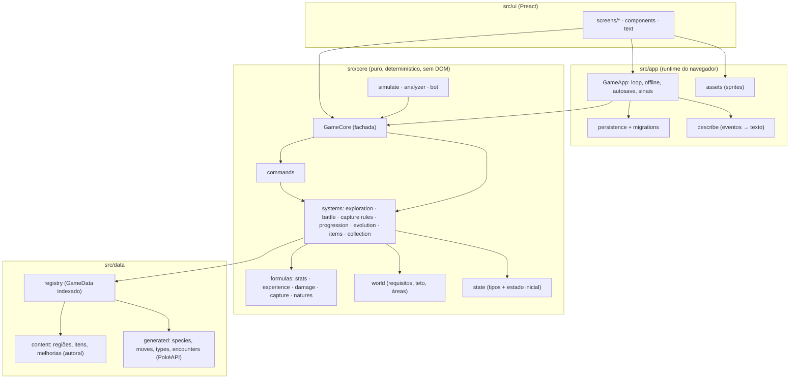
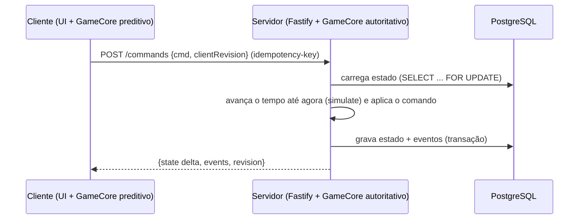

# Pokémon Idle — Arquitetura Técnica

> Versão 0.2. Descreve a arquitetura **implementada** e o caminho para as fases com servidor. Complementa o
> [GDD](./GDD.md), [ECONOMY.md](./ECONOMY.md) e [ROADMAP.md](./ROADMAP.md).

---

## 1. Decisões e justificativas

| Tema | Decisão | Por quê |
|---|---|---|
| Linguagem | TypeScript strict | Centenas de espécies e dezenas de sistemas exigem tipos fortes |
| Build | Vite | Rápido, gera estático e separa os dados em chunks |
| UI | Preact + Signals | API do React em ~4 kB; o plano mestre sugere React, e a migração é trivial (mesma API) se for necessário |
| Renderização | DOM/CSS (sem PixiJS por enquanto) | A cena de batalha tem 2 sprites e efeitos simples. O PixiJS fica para mapas animados e raids, se vierem |
| Motor do jogo | **Core isomórfico e determinístico** em `src/core` | Roda igual no navegador, nos testes, no simulador (Node) e, no futuro, no servidor |
| Persistência | IndexedDB (fallback localStorage), envelopes gzip + checksum | Saves grandes, detecção de corrupção, backups |
| Testes | Vitest (unidade + integração + simulação) | Mesmo pipeline do Vite |
| Hospedagem | **Vercel** (estático) | O repositório já estava conectado à Vercel; deploy automático do branch principal e preview por branch |
| Backend futuro | **Node + Fastify + PostgreSQL**, rodando o mesmo core | Atende ao plano mestre (servidor autoritativo). O Firebase continua como alternativa atrás da interface `SaveRepository` (§9) |

**Divergência consciente do plano mestre:** o plano pede backend autoritativo desde a Fase 1. Para entregar algo jogável
sem infraestrutura nem credenciais, o MVP roda **no cliente**. Mas toda a lógica vive num core puro e determinístico, e
a UI só envia **comandos**. Na fase multiplayer, o servidor executa o mesmo `GameCore` e passa a ser a autoridade sem
reescrever regras (§8).

---

## 2. Camadas e dependências



**Regra:** `ui → app → core → data`. O `core` nunca importa `app`, `ui`, DOM ou bibliotecas de rede. A UI **lê** o
estado e **escreve apenas via `dispatch(Command)`**.

### 2.1 Estrutura de pastas
```
docs/                     GDD, ARCHITECTURE, ECONOMY, ROADMAP
PROJECT_STATUS.md         status vivo do projeto
scripts/
  build-data/             PokéAPI CSV → src/data/generated (npm run build:data)
  sim/                    simulador de balanceamento (npm run sim -- <horas> <seed>)
  download-sprites.ts     sprites locais opcionais (npm run sprites:download)
src/
  core/                   motor do jogo (ver §3)
  data/                   tipos, registry, content (autoral), generated (gerado)
  app/                    runtime do navegador, persistência, assets
  ui/                     App, componentes, telas, estilos
tests/                    Vitest
```

---

## 3. Core do jogo

### 3.1 Estado
`GameState` é um único objeto JSON serializável (ver `src/core/state/types.ts`). Contém:
- jogador, equipe, Pokémon (indexados por uid) e PC;
- Pokédex, Afinidade, Maestria, inventário e melhorias;
- mundo (área ativa, progresso por área), exploração (fase, batalha corrente) e regras de captura;
- configurações do Auto Manager, boosts e estatísticas;
- sessão de hunt e o **estado do RNG**.

Os atributos finais **não são salvos**: são derivados (`pokemonStats`).

### 3.2 Contexto e determinismo
Todos os sistemas recebem `GameContext { data, rng, now, emit }`.
- `rng`: mulberry32, com o estado dentro do `GameState`. Mesmo estado + mesmos comandos = mesmo resultado; há teste
  disso.
- `now`: relógio de parede, usado apenas para o horário do dia e para carimbos de data.
- `emit`: eventos de domínio para observadores (log, notificações, resumo offline). A lógica não depende deles.

### 3.3 Tick
`tickExploration(ctx, state, dt)` avança a máquina de estados `idle → walking → battle → healing`. No navegador o passo é
fixo, de 100 ms (acumulador), e a UI é atualizada no máximo a cada 200 ms. Em segundo plano roda a 1 Hz; ausências
acima de 60 s viram **progresso offline**.

### 3.4 Comandos
`ChooseStarter, SelectArea, SetParty, BuyItem, SellItem, UseItem, HoldItem, BuyUpgrade, Transfer, ToggleLock, Rename,
Evolve, SetSettings, SetCaptureRules, SavePreset/LoadPreset/DeletePreset, SetPlayerName`.

Cada comando valida pré-condições e retorna `Result`. Essa camada é exatamente a que vira a **API do servidor** no
futuro.

### 3.5 Simulação acelerada (um só motor)
`simulate(data, state, ms)` roda o **mesmo `tick`** em passos de 500 ms, a ~100–200 ms de CPU por hora de jogo. Ela
alimenta três coisas:
- **Progresso offline:** `tempoAusente` limitado (8 h base) × eficiência (50% base). Roda em fatias de 40 ms com barra de
  progresso e gera o Relatório de Retorno. Por usar o motor real, não existe divergência entre o online e o offline.
- **Hunt Analyzer:** simula uma **cópia** do estado (semente fixa) por 10–20 min em cada área.
- **Simulador de balanceamento:** `scripts/sim` usa um bot (`core/bot.ts`) que joga como um jogador casual.

---

## 4. Dados

### 4.1 Gerados (`npm run build:data`)
Saem dos CSVs da PokéAPI, em cache em `.cache/`:
- `species.json`: 1025 espécies com atributos, EVs, curva, taxa de captura, XP base, amizade, gênero, cadeia,
  **evoluções normalizadas** e learnset por nível do jogo mais recente.
- `moves.json`: golpes referenciados.
- `types.json`: tabela 18×18.
- `items.json`: nomes.
- `encounters-{kanto,johto,hoenn,sinnoh}.json`: tabelas por local, unindo versões, com método e horário.

Regras de conversão das evoluções:
- troca → `Cabo de Ligação`;
- "usar golpe N vezes" → conhecer o golpe;
- Wurmple → personalidade;
- Shedinja → evolução especial;
- variantes regionais ficam de fora.

Os JSON gerados são versionados (o deploy não depende da PokéAPI) e ficam em chunks separados no bundle (~150 kB gzip).

### 4.2 Autorais (`src/data/content`)
- `regions/*.ts`: áreas em ordem, locais combinados, requisitos, treinadores (quantidade/classes ou equipes fixas),
  ginásios, Liga, lendários, encontros extras, recompensas e transformação de nível/Tier.
- `items.ts`: efeitos, preços e insígnias para a loja.
- `upgrades.ts`: melhorias, marcos da Pesquisa e limiares de Afinidade/Maestria.

### 4.3 Registry
`createGameData()` combina tudo, **valida referências** (local inexistente quebra o carregamento) e monta:
- índices `Map`;
- slots combinados por área com o nível já transformado;
- treinadores de rota gerados de forma **determinística** (hash do id da área);
- a faixa de nível e o Tier de cada área.

---

## 5. Persistência
- `SaveEnvelope { saveVersion, savedAt, revision, checksum (FNV-1a), payload (gzip+base64) }`.
- Repositórios: `IndexedDbRepository` (padrão), `LocalStorageRepository` (fallback) e `MemoryRepository` (testes).
- **Autosave:** a cada 30 s, ao ocultar a aba, em `pagehide` e após eventos importantes.
- **Backups rotativos:** `main → backup-1 → backup-2`. Quando o `main` falha no checksum ou na validação, o jogo carrega
  o próximo slot.
- **Migrações:** `migrations.ts` aplica `MIGRATIONS[v]` em sequência e faz uma validação estrutural.
- Exportar/importar como string.

---

## 6. Assets
- `app/assets.ts` resolve as URLs a partir de `VITE_SPRITE_BASE`. O padrão é o repositório público de sprites da
  PokéAPI.
  - Os estáticos cobrem as 1025 espécies (frente, costas e shiny).
  - Os animados da Gen 5 cobrem até #649.
  - Se um animado falhar, usa o estático; se o estático falhar, o sprite fica oculto.
- `npm run sprites:download` copia tudo para `public/assets/sprites` (fora do git) para servir localmente.
- Nada de sprite é versionado no repositório (§15 do GDD).

---

## 7. Desempenho medido

| Item | Medida |
|---|---|
| JS inicial | ~60 kB gzip (+ ~150 kB gzip de dados em chunks paralelos) |
| Tick (100 ms de jogo) | < 0,1 ms em média |
| Simulação | ~0,15–0,2 s de CPU por hora de jogo (offline de 24 h ≈ 3–4 s, em fatias) |
| Testes | 27 testes em ~1–2 s |

---

## 8. Caminho para o backend autoritativo (Fases 6+)



- O servidor roda **o mesmo `src/core`** (extraído para `packages/game-engine`). O tempo vem do servidor (sem trapaça de
  relógio) e o RNG é semeado no servidor.
- O cliente continua simulando localmente para fluidez (**predição**) e reconcilia pela `revision`.
- Comandos idempotentes, com `Idempotency-Key`; a concorrência é otimista por `revision`.
- Ranking, mercado e guildas exigem o servidor. Pontuações enviadas pelo cliente nunca são confiáveis.

### 8.1 Modelo inicial do banco (PostgreSQL)
| Tabela | Campos principais | Observações |
|---|---|---|
| `users` | id, email, created_at, status | Autenticação (OAuth/e-mail) |
| `trainer_profiles` | user_id PK/FK, name, badges[], champions[], dex_caught, public | Perfil público e ranking |
| `game_states` | user_id PK, revision, save_version, state JSONB, updated_at | Estado autoritativo (cache quente no Redis) |
| `pokemon_instances` | id, owner_id, species, level, xp, ivs JSONB, evs JSONB, nature, shiny, locked, origin, caught_at, caught_area | Normalizado quando o mercado existir (propriedade e escrow) |
| `inventory` | user_id, item_id, qty | `CHECK (qty >= 0)` |
| `transactions` | id, user_id, kind, currency, amount, ref, created_at | Livro-razão da economia, só por inserção |
| `capture_log` | id, user_id, species, area, ball, chance, success, at | Auditoria (amostrada) |
| `battles` | id, user_id, kind, area, result, seed, at | Replays (semente + comandos) |
| `market_listings` | id, seller_id, pokemon_id/item_id, price, status, created_at | Escrow por status + FK única ativa |
| `guilds`, `guild_members` | … | Fase 6 |
| `leaderboards` | season, metric, user_id, value, verified | Gravado só pelo servidor |
| `achievements`, `missions`, `events` | … | Fase 4/7 |

Os índices ficam em `(owner_id, species)`, `(season, metric, value DESC)` e `(status, created_at)` para o mercado.

### 8.2 Alternativa Firebase
Se a preferência for Firebase (pedido inicial), a mesma divisão vale:
- `SaveRepository` → Firestore;
- comandos → Cloud Functions rodando o core;
- leaderboards gravados só por Functions.

Recomendação: **Postgres + Fastify**, pelas transações (mercado e escrow) e pelos relatórios.

---

## 9. Plano de testes
| Nível | O que cobre | Onde |
|---|---|---|
| Unidade | Curvas de XP (valores oficiais), atributos (valores de referência), tipos, dano, captura, RNG | `tests/formulas.test.ts` |
| Dados | 1025 espécies, referências válidas, ids únicos, 32 insígnias, Pokédex de Kanto 100% obtível, níveis 1–100 | `tests/data.test.ts` |
| Integração | Comandos e validações, determinismo, 30 min na Rota 1, Centro Pokémon, evoluções (nível, pedra, cabo, item, gênero, personalidade, Everstone, Shedinja), regras de captura + transferência automática | `tests/gameplay.test.ts` |
| Persistência | Round-trip, checksum → backup, export/import, migrações e rejeições | `tests/persistence.test.ts` |
| Balanceamento | Simulação de 12 h no CI e simulações longas manuais com várias sementes | `scripts/sim` + CI |
| E2E (manual) | Playwright: escolher inicial, explorar, navegar pelas telas, Hunt Analyzer e celular | roteiro em PROJECT_STATUS.md |

O CI (`.github/workflows/ci.yml`) roda typecheck, testes, build e a simulação a cada push.

## 10. Escalabilidade
- **Conteúdo:** novas regiões são um arquivo em `content/regions/` mais as versões no `build-data`. As espécies e os
  dados até a Gen 9 já estão gerados.
- **Coleção grande:** estado em mapa por uid. O PC renderiza até 600 células por vez, com busca e filtros. Acima de
  ~20 mil Pokémon, trocar o serializer por tuplas.
- **CPU:** a simulação offline é linear no tempo e limitada pelo teto offline; em servidor, cada usuário é avançado sob
  demanda (lazy), sem tick global.
- **Servidor:** stateless (o estado vem do Postgres, com cache no Redis); escala horizontal atrás de um balanceador. O
  WebSocket entra só para eventos sociais.
