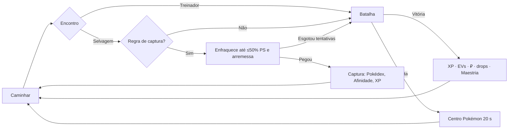

# Pokémon Idle — Game Design Document (GDD)

> Versão 0.2. Documenta as regras **como estão implementadas**, com números calibrados no simulador (ver
> [ECONOMY.md](./ECONOMY.md)).
> Projeto de fã, não comercial. Pokémon e marcas relacionadas pertencem à Nintendo / Game Freak / Creatures / The Pokémon
> Company (ver §14).
> Referência de gênero: jogos idle de captura como o PokéIdle.io. As regras abaixo são próprias deste projeto, não uma
> cópia de números ou sistemas de outro jogo.

---

## 1. Visão geral

**Gênero:** idle/incremental de captura e coleção, com RPG leve, jogado no navegador (desktop e celular).

**Pitch:** você escolhe uma área e sua equipe explora sozinha: enfrenta Pokémon selvagens e treinadores, captura conforme
as **regras que você configurou**, sobe de nível e evolui. Você volta para decidir onde caçar, quem treinar, o que comprar
e quando desafiar ginásios e ligas. O progresso continua offline.

### 1.1 Pilares
1. **Progresso sempre visível:** a cada poucos segundos há uma batalha, XP, ₽ ou um registro novo.
2. **Decisões estratégicas no lugar de cliques:** área, composição da equipe, regras de captura, itens e melhorias.
3. **A coleção é o motor:** toda captura melhora algo (Pokédex, Afinidade, Pesquisa, PP).
4. **Transparência:** projeções (Hunt Analyzer), chances de captura no log e requisitos sempre visíveis.
5. **Respeito ao tempo do jogador:** offline rende, e as automações são configuráveis e auditáveis.

---

## 2. Loops de jogo

| Escala | Loop |
|---|---|
| Segundos | Caminhar (3,5 s) → encontro → batalha por turnos (0,8 s/ação) → captura ou nocaute → XP/₽ |
| Minutos | Level up → evolução → concluir área → nova área liberada |
| Horas | Comprar bolas e melhorias → enfrentar o ginásio → insígnia sobe o teto de nível |
| Dias | Liga → Campeão → nova região; marcos da Pokédex dão bônus permanentes |
| Semanas | Shinies, IVs S, Afinidade/Maestria máximas, Academia, lendários |



---

## 3. Exploração (Hunts)

- O jogador escolhe **uma área ativa**. A cada ciclo, a equipe caminha `3,5 s` (com Tênis de Corrida até −57%, e a
  Bicicleta dá −20%) e então ocorre um evento:
  - **Treinador de rota** (20% de chance enquanto houver treinadores não derrotados na área; 100% se a área não tem
    selvagens disponíveis).
  - **Lendário** da área (chance própria, ex.: 1/400), apenas enquanto ainda não foi capturado.
  - **Selvagem:** sorteio na tabela de encontros.
- **Tabela de encontros:** gerada a partir dos dados reais dos jogos (FireRed/LeafGreen, HeartGold/SoulSilver,
  Ruby/Sapphire/Emerald, Diamond/Pearl/Platinum), combinando versões e andares da mesma área.
  - **Métodos:** a pé (70), Surf (25), Vara Velha (6), Vara Boa (8), Super Vara (10), Rock Smash e Headbutt (8). O
    peso relativo de cada método só conta quando o jogador tem o item necessário.
  - **Horário do dia** (relógio local): manhã 4h–10h, dia 10h–20h, noite 20h–4h. Altera os encontros (em Johto e
    Sinnoh) e as evoluções.
- **Concluir a área:** `vitórias ≥ winsToClear × 4` **e** todos os treinadores de rota derrotados. Áreas sem encontros a
  pé (ex.: S.S. Anne) exigem apenas os treinadores.
  - Recompensa: +5 PP, itens-chave (ex.: S.S. Anne → Vara Velha) e a liberação das próximas áreas.
- **Repel:** enquanto ativo, ignora selvagens 5 níveis abaixo do líder.
- **Regeneração ao caminhar:** 3% dos PS/s (+1% por nível de "Lanche de Viagem"). Pokémon desmaiados regeneram na metade
  da taxa e só voltam a lutar com 50% dos PS. Em ginásios e ligas **não há regeneração**.

---

## 4. Batalhas automáticas

- Equipe de até 6. O **primeiro Pokémon apto** luta; ao desmaiar, entra o próximo.
- **Rodadas:** a ordem segue a prioridade do golpe e depois a Velocidade (empate no sorteio). Cada ação dura `0,8 s`
  (−10% por nível de "Velocidade de Batalha").
- **IA de golpe:** escolhe o maior dano esperado, considerando poder × STAB × efetividade × precisão × razão de
  atributos.
  - **Golpes conhecidos:** os 4 de dano mais fortes aprendidos até o nível atual (learnset do jogo mais recente da
    espécie).
  - **Golpes de dois turnos** (Hyper Beam, Solar Beam…) contam metade do poder.
  - **Golpes excluídos:** os que se autodestroem ou que dependem de condições fora do sistema (Explosion, Dream Eater,
    Focus Punch…).
  - **Sem golpe de dano** (Abra, Metapod…): usa Struggle (50, sem tipo).
- **Dano** (Gen 5+):
  `((2·Nv/5+2)·Poder·A/D)/50 + 2` × crítico (1,5 em 1/24) × aleatório (0,85–1) × STAB 1,5 × efetividade × item
  segurado. A tabela de tipos completa tem 18 tipos.
- **Atributos** (fórmula oficial): `⌊(2B + IV + ⌊EV/4⌋)·Nv/100⌋ + 5`, × natureza (±10%), × bônus permanentes
  (Afinidade, Maestria, Pesquisa, Academia). Para PS: `+ Nv + 10`.
- **Obediência:** acima do teto de nível atual, o Pokémon luta como se estivesse no teto. Isso impede que uma captura de
  nível alto (ex.: Super Vara) quebre a progressão.
- **Oponentes:**

| Tipo | Recompensa | Observações |
|---|---|---|
| Selvagem | XP, `₽ = 2 + 1,2·Nv`, drop 4% | Pode ser capturado |
| Treinador de rota | XP ×1,5, `₽ = valor da classe × maior nível`, +1 PP (1ª vez) | 1–3 Pokémon, gerados de forma determinística a partir da área |
| Ginásio | Treinadores + Líder em sequência sem regeneração; insígnia, ₽, itens, PP | Ao perder, volta à última área de farm |
| Liga | Elite Four + Campeão em sequência; libera a próxima região | A revanche paga só 25% do prêmio e 10% do dinheiro dos treinadores, sem PP |

- **Derrota:** Centro Pokémon por `20 s` (−15% por nível de "Enfermeira"). Com "Recuar" ligado, 3 derrotas seguidas
  levam a equipe à área anterior.

---

## 5. Captura e atributos individuais

### 5.1 Regras de captura (Auto Manager)
Lista ordenada e editável. A **primeira regra** que combina com o selvagem define a bola:

| Condição | Padrão |
|---|---|
| Shiny | Ultra Ball (reserva: qualquer bola) |
| Lendário / mítico | Ultra Ball |
| Não registrado na Pokédex | Poké Ball |
| IVs melhores que a minha melhor cópia | desligada |
| Espécies específicas | o jogador cria |
| Qualquer Pokémon (farm de Afinidade) | desligada |

**Mecânica:** com uma regra ativa, a equipe ataca **sem nocautear** (o dano para em 1 PS) e arremessa quando o selvagem
está com **≤ 50% dos PS** (Quick Ball e Master Ball arremessam no primeiro turno).
- Há até `3` tentativas (+1 por nível de "Persistência").
- Se as tentativas acabarem, a batalha segue normalmente. Lendários **fogem** e podem reaparecer.
- **Shinies** têm até 30 tentativas, enquanto houver bolas, e nunca são nocauteados enquanto houver tentativas.
- Capturar também dá XP (como um nocaute), mas não dá dinheiro.
- A **reserva** usa a bola mais barata disponível quando a da regra acaba, e nunca a Master Ball.

### 5.2 Chance por arremesso
```
fatorPS    = (3·PSmax − 2·PSatual) / (3·PSmax)
fatorNível = clamp(1 + (NvJogador − NvSelvagem)·0,02, 0,6, 1,4)
chance     = clamp( taxaCaptura/255 · bola · fatorPS · fatorNível · 1,1 (se já registrado) · (1 + bônus), 0, 1 )
```
Os bônus vêm da Técnica de Arremesso (+5%/nível), de marcos da Pesquisa e do Oval Charm (+10%).

| Bola | Mult. | Preço | Loja (insígnias) |
|---|---|---|---|
| Poké Ball | ×1 | 200 | 0 |
| Great Ball | ×1,5 | 600 | 1 |
| Ultra Ball | ×2 | 1.200 | 4 |
| Net Ball | ×3 Água/Inseto | 1.000 | 2 |
| Dusk Ball | ×3 à noite ou em caverna | 1.000 | 3 |
| Quick Ball | ×4 no 1º arremesso | 1.000 | 3 |
| Repeat Ball | ×3,5 se já registrado | 1.000 | 3 |
| Master Ball | 100% | — | marcos e Liga |

### 5.3 Shiny
A chance base é de **1/8192** por encontro selvagem. "Olhar Treinado" dá +25% por nível (até ×2,5) e o Shiny Charm
(marco de 150 espécies) dá ×2. Shinies são protegidos automaticamente e contam 5 pontos de Afinidade. O contador
"encontros desde o último shiny" é só informativo: não há garantia de piedade.

### 5.4 Individualidade, qualidade e coleção
- Cada Pokémon tem **IVs** (0–31 por atributo), **natureza** (25), gênero, personalidade (decide evoluções como a de
  Wurmple), amizade, EVs (ganhos ao derrotar espécies, até 252 por atributo e 510 no total) e item segurado.
- **Qualidade** (nota agregada, só para leitura): S ≥ 90% da soma máxima de IVs, A ≥ 75%, B ≥ 55%, C ≥ 35%, D abaixo
  disso. A raridade da espécie é um eixo separado.
- **Afinidade (coleção):** cada captura dá +1 ponto para a **linha evolutiva** (+5 se shiny). Os níveis 1–10 exigem 1,
  3, 6, 10, 16, 25, 40, 60, 90 e 130 pontos, e cada nível dá **+3% de atributos** a toda a linha.
- **Maestria (uso):** vitórias como Pokémon ativo, por espécie. Os níveis 1–10 exigem de 25 a 16.000 vitórias, e cada
  nível dá **+1% de atributos e +2% de XP**. O bônus é limitado (+10%/+20%) para não tornar uma espécie obrigatória.
- **Transferência ao Professor:** remove o Pokémon e dá `₽ = (10 + 3·Nv + (255 − taxaCaptura)/2)` (×10 se shiny) e
  `PP = 2 se raro (taxa ≤ 45) + 20 se lendário + 10 se shiny`. Duplicatas comuns rendem só ₽.
  - Pode ser automática no Auto Manager, para duplicatas que não sejam shiny, não estejam protegidas, não superem a
    melhor cópia em IVs e fiquem abaixo da nota protegida.
  - Ações em massa pedem confirmação.

---

## 6. Pokédex e Pesquisa do Professor
- Estados: não visto, visto, capturado e shiny capturado, com contadores de encontros e capturas por espécie.
- Pokédex regionais (Kanto 151, Johto 100, Hoenn 135, Sinnoh 107) e a Nacional (1025).
- O detalhe mostra atributos base, a linha evolutiva com as condições e os locais onde a espécie aparece. Espécies não
  vistas aparecem como "???".
- Cada **espécie nova** dá +2 PP.
- **Marcos** (espécies capturadas → recompensa permanente) em 5, 10, 20, 30, 40, 50, 65, 80, 100, 120, 140, 150, 200,
  250, 300, 386, 450 e 493:
  - multiplicadores de XP, ₽, captura e atributos;
  - itens: Lucky Egg, Amulet Coin, Leftovers, Master Ball, Oval/Shiny Charm;
  - Pokémon míticos de presente: Mew (150), Celebi (250), Jirachi (386), Manaphy (493).

---

## 7. Níveis, XP e teto

- As 6 curvas oficiais de crescimento.
- **XP por oponente**, com a escala da Gen 5:
  `XP = (baseExp · NvOponente / 5) · ((2F + 10) / (F + P + 10))^2,5 · 1,5 (se treinador) · 0,25 (ritmo global)`.
  Aqui F é o nível do oponente e P o nível de quem recebe a XP. Farmar áreas muito fracas rende pouco.
- **Multiplicadores:** participantes recebem 100% e os demais aptos recebem a **Exp. Share** (25% base, +10% por nível
  até 95%). Ainda contam Lucky Egg ×1,5, Maestria e os bônus globais.
- **Teto de nível** (sem XP acima dele), que é o maior entre as regiões liberadas:

| Insígnias da região | 0 | 1 | 2 | 3 | 4 | 5 | 6 | 7 | 8 | Campeão |
|---|---|---|---|---|---|---|---|---|---|---|
| Kanto | 16 | 23 | 27 | 32 | 45 | 46 | 50 | 53 | 65 | 70 |
| Johto | 72 | 75 | 78 | 81 | 85 | 88 | 91 | 95 | 100 | 100 |
| Hoenn / Sinnoh | 100 | … | | | | | | | | 100 |

- **Poder depois do nível 100** (eixos horizontais):
  - Afinidade: +30%;
  - Maestria: +10%;
  - marcos da Pesquisa: +17%;
  - **Academia Pokémon**: +1% por nível, até +50%;
  - EVs, IVs e itens segurados.
  Hoenn e Sinnoh aplicam um **Tier de Região** nos atributos dos oponentes (×1,25 e ×1,6) para exigir esse poder.

---

## 8. Evolução

O sistema é orientado a dados, com condições extraídas do jogo mais recente de cada espécie. Uma evolução pode ter
vários caminhos, e cada caminho exige que **todas** as suas condições sejam atendidas.

| Condição | Idle |
|---|---|
| Nível | Automática ao subir de nível (pode ser desligada) |
| Pedra/item | Usar o item no Pokémon |
| Troca | **Cabo de Ligação** (item consumível, ₽3.000) |
| Troca + item segurado | Segurar o item e usar o Cabo de Ligação (o item é consumido) |
| Amizade ≥ 160 | +1 a cada 3 vitórias (×2 com Soothe Bell), +2 por nível |
| Dia/noite | Relógio local |
| Conhecer golpe/tipo | Golpe aprendido até o nível atual |
| Atk vs Def (Tyrogue) | Atributos atuais |
| Gênero (Gallade, Froslass…) | Gênero do indivíduo |
| Personalidade (Wurmple) | `personalidade mod 2` |
| Pokémon/tipo na equipe | Mantyke + Remoraid, Pancham + tipo Sombrio |
| Shedinja | Aparece junto quando Nincada evolui, consumindo 1 Poké Ball |
| Gatilhos sem equivalente | Kingambit (Nv 64), Gholdengo (40), Melmetal (48) |

Everstone impede a evolução. Variantes regionais ficam para uma etapa futura.

---

## 9. Regiões e progressão

| Região | Áreas | Ginásios | Nível dos oponentes | Tier | Lendários |
|---|---|---|---|---|---|
| Kanto | 46 | 8 + Liga | dados originais (2–70) | ×1 | Articuno, Zapdos, Moltres, Mewtwo |
| Johto | 50 | 8 + Liga | `59 + 0,85·Nv` (≈60–100) | ×1 | Raikou, Entei, Suicune, Lugia, Ho-Oh |
| Hoenn | 51 | 8 + Liga | `60 + 0,65·Nv` | ×1,25 | Regis, Latios/Latias, Kyogre, Groudon, Rayquaza |
| Sinnoh | 53 | 8 + Liga | `70 + 0,5·Nv` | ×1,6 | Trio dos lagos, Dialga, Palkia, Heatran, Regigigas, Giratina, Cresselia |

- Os líderes de ginásio, a Elite Four e os Campeões usam as equipes canônicas (FRLG, HGSS, Emerald, Platinum).
- **Encontros extras** cobrem Pokémon que no jogo original eram presentes ou fósseis: iniciais raros em rotas, fósseis,
  Eevee, Lapras, Snorlax, Porygon, Hitmonlee/Hitmonchan etc. Assim a Pokédex de Kanto é 100% obtível, o que é
  verificado por teste.
- **Itens-chave:**
  - Bicicleta: Cerulean;
  - Vara Velha: S.S. Anne;
  - Vara Boa: Rota 12;
  - HM Surf e Super Vara: Zona Safari.

### 9.1 Ritmo medido (simulador, Kanto)
| Marco | Tempo de jogo simulado |
|---|---|
| 10 espécies | ~0,4 h |
| Insígnia 1 | ~1,7 h |
| Insígnia 4 | ~4,3 h |
| Insígnia 8 | ~6,5 h |
| Campeão de Kanto | ~8,5–12 h |

Depois de Kanto (simulado): Johto até ~16 h, Hoenn até 29–41 h, as 8 insígnias de Sinnoh até 40–52 h, e a Liga de
Sinnoh como meta de longo prazo.

Na prática: com 2 h ativas por dia e 8 h offline a 50%, Kanto leva cerca de 2 dias de calendário, e cada região seguinte
é mais longa. Detalhes e premissas em [ECONOMY.md](./ECONOMY.md).

---

## 10. Itens
- **Bolas, Poções** (20/60/120/total), **Revive** (50%) e **Rare Candy** (respeita o teto).
- **Vitaminas:** +10 EVs, ₽9.800.
- **Pedras e itens de evolução:** pedras a ₽2.100 com 4 insígnias; outros itens a ₽4.000 com 6 insígnias.
- **Itens segurados:**
  - de tipo: +20% no tipo, ₽3.000;
  - Muscle Band e Wise Glasses: +10%;
  - Leftovers: 1/16 dos PS por turno;
  - Lucky Egg (XP ×1,5) e Amulet Coin (₽ ×1,5);
  - Everstone e Soothe Bell.
- **Repel / Super / Max:** 30, 60 e 120 min.
- **Drops** em 4% das vitórias contra selvagens; a tabela melhora com as insígnias.

---

## 11. Economia
- **Moedas:**
  - **Pokédólar (₽):** batalhas e transferências. Gasto em loja, melhorias, Academia e caixas do PC.
  - **Pontos de Pesquisa (PP):** espécies novas, treinadores, áreas concluídas, ginásios, Liga e transferências. Gastos
    em melhorias de laboratório.
- **Melhorias:**
  - Em ₽: Tênis de Corrida, Moeda da Sorte, Técnica de Arremesso, Enfermeira, Lanche, Caixas do PC e Academia
    (infinita, de baixo crescimento).
  - Em PP: Treinamento, Exp. Share, Velocidade de Batalha, Persistência, Diário (limite offline), Equipe Autônoma
    (eficiência offline), Olhar Treinado (shiny) e Comprador Automático.
  - Custo: `base · crescimento^nível`.
- **Sumidouros:** bolas, poções, vitaminas, Academia, Caixas do PC e Cabo de Ligação.
- **Anti-inflação:** a revanche da Liga paga pouco, os selvagens pagam pouco (o dinheiro grande vem de treinadores e
  ginásios) e a Academia absorve o excedente no fim do jogo.
- Análise completa em [ECONOMY.md](./ECONOMY.md).

---

## 12. Ferramentas de otimização
- **Hunt Analyzer:** projeta XP/h, ₽/h, encontros/h, capturas/h, derrotas/h, taxa de vitória e eficiência
  (`XP/h × vitória²`).
  - A projeção roda **o motor real** numa cópia do estado, com semente fixa (10–20 min de amostra).
  - Está disponível por área (Mapa) e como comparação de todas as áreas liberadas (Análises).
  - A interface rotula os números como projeção e mostra as premissas.
- **Hunt atual:** métricas reais da sessão na área.
- **Auto Manager:**
  - regras de captura;
  - poção automática por limite de PS e Revive automático;
  - recuo após derrotas;
  - evolução automática;
  - transferência automática com proteção por nota de IV;
  - comprador automático com estoque mínimo e orçamento máximo (% do dinheiro).
- **Presets de equipe:** até 8.
- **Estatísticas da conta:** batalhas, capturas, shinies, ₽, XP, tempo offline e taxa de captura por arremesso.

---

## 13. Interface
- Pixel art com sprites animados da Gen 5 (até #649) e estáticos para o resto, sempre com `image-rendering: pixelated`.
- Tema escuro e claro, com janelas em estilo de caixa de diálogo de RPG.
- **Telas:** Explorar (cena de batalha com HUD, log, métricas, tabela de encontros), Mapa, Equipe, PC, Pokédex,
  Mochila, Loja, Pesquisa, Auto Manager, Análises e Config.
- **Responsivo:** navegação lateral no desktop e barra de abas inferior no celular. Respeita `prefers-reduced-motion`.

## 14. Fora do escopo atual (próximas fases)
Ver [ROADMAP.md](./ROADMAP.md): backend autoritativo e conta na nuvem, ranking, mercado entre jogadores, guildas, PvP,
raids, status de batalha e habilidades, criação (breeding), eventos sazonais, conquistas e variantes regionais.

## 15. Propriedade intelectual
- Sprites "disponíveis publicamente" não vêm com licença dos titulares.
- O código mantém **assets e nomes desacoplados**: um pacote de sprites configurável (`VITE_SPRITE_BASE`) e nomes nos
  dados. Por padrão nada é versionado no repositório; o jogo carrega os sprites do repositório público da PokéAPI.
- Para uma publicação pública seria necessário substituir por assets licenciados/originais ou obter autorização, como
  diz o plano mestre.
- A tela de Créditos traz o aviso de projeto de fã.
