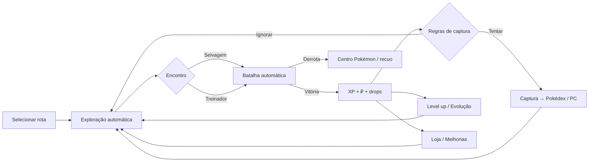

# Pokémon Idle — Game Design Document (GDD)

> Versão 0.1 — proposta inicial para revisão.
> Projeto de fã, não comercial. Nomes e sprites de Pokémon pertencem à Nintendo / Game Freak / The Pokémon Company (ver §13).

---

## 1. Visão geral

**Gênero:** idle / incremental com coleção e RPG leve, jogado no navegador.
**Plataformas:** desktop e mobile (web responsivo, instalável como PWA no futuro).
**Sessão típica:** de 2 a 10 minutos ativos, várias vezes ao dia, com progresso contínuo offline.

**Pitch:** você escolhe uma rota e sua equipe explora sozinha, batalha e captura Pokémon selvagens. Você volta para
reorganizar a equipe, gastar o dinheiro, evoluir Pokémon, vencer líderes de ginásio e liberar novas rotas e regiões. O
objetivo de longo prazo é completar a Pokédex de todas as regiões e montar a equipe mais forte.

### 1.1 Pilares de design

1. **Progresso sempre visível.** A cada minuto acontece algo: XP, dinheiro, um registro novo na Pokédex.
2. **Decisões que importam.** O idle cuida da repetição. O jogador decide onde farmar, quem treinar, qual Poké Bola usar
   e o que comprar.
3. **A coleção é o motor.** Capturar (inclusive duplicatas) sempre melhora alguma coisa: Pokédex, Afinidade, pesquisa.
4. **Respeito ao tempo do jogador.** O tempo offline rende de verdade, e não há punição por ficar longe.
5. **Fiel ao espírito da série.** Tipos, evoluções, ginásios e regiões funcionam como o fã espera, simplificados para o
   formato idle.

---

## 2. Loops de jogo

| Escala | Loop | O que o jogador sente |
|---|---|---|
| **Segundos** | Encontro → batalha automática → XP/dinheiro → tentativa de captura | "Está acontecendo coisa." |
| **Minutos** | Pokémon sobe de nível → evolui → equipe fica mais forte → muda para rota mais difícil | "Estou ficando forte." |
| **Horas** | Junta dinheiro → compra bolas e melhorias → enfrenta treinadores e o ginásio → libera rotas | "Avancei na história." |
| **Dias** | Fecha a Pokédex da região → vence a Liga → libera nova região, novos bônus de pesquisa | "Minha coleção está crescendo." |
| **Semanas** | Caça a shinies, IVs perfeitos, Afinidade máxima, ranking | "Estou otimizando." |



---

## 3. Exploração

- O jogador seleciona **uma rota ativa** dentro de uma região liberada.
- A equipe "caminha" pela rota. A cada **intervalo de encontro** (base de 4 s, reduzido até 1,5 s com melhorias) ocorre
  um evento:
  - **Selvagem** (padrão): sorteio ponderado na tabela de encontros da rota.
  - **Treinador** (se ainda houver treinadores não derrotados na rota): chance de 15%.
  - **Item encontrado** (chance baixa): dinheiro, bolas, poções e, raramente, pedras evolutivas.
- **Tabela de encontros** por rota: `espécie`, `peso`, `nível mín./máx.` e condições opcionais (`dia`/`noite`,
  `requer insígnia X`, `após capturar Y`).
- **Horário do dia** segue o relógio local: manhã (6h–12h), dia (12h–18h) e noite (18h–6h). Altera encontros e algumas
  evoluções.
- **Contador de derrotas por rota:** vencer N batalhas numa rota (ex.: 10) libera a próxima rota do mapa, desde que o
  requisito de ginásio já tenha sido cumprido.
- **Maestria de rota:** capturar todas as espécies de uma rota a marca como ★ e dá um bônus permanente de +5% de
  dinheiro naquela rota.

---

## 4. Batalhas automáticas

### 4.1 Estrutura
- A equipe tem até **6 Pokémon**, que lutam **em ordem**: o líder luta até desmaiar e então entra o próximo.
- Batalha por turnos em tempo real. Cada ação dura **~0,6 s** (com velocidade ajustável de 1x, 2x ou 4x após
  melhoria).
- A ordem de ação é decidida pela **Velocidade**; em caso de empate, sorteio.
- A IA escolhe o golpe com o **maior dano esperado** (considera tipo, STAB e precisão).

### 4.2 Golpes
- Cada espécie tem um **learnset por nível** (dados gerados). O Pokémon conhece automaticamente os 4 golpes de dano
  mais fortes já aprendidos.
- **Na primeira versão** os golpes são apenas ofensivos (Poder, Tipo, Categoria Físico/Especial, Precisão). Status e
  efeitos secundários ficam para depois (ver §12).

### 4.3 Fórmulas
**Atributos** (padrão da série, simplificado):
```
HP    = floor((2·Base + IV + floor(EV/4)) · Nv / 100) + Nv + 10
Outro = floor((floor((2·Base + IV + floor(EV/4)) · Nv / 100) + 5) · Natureza) · (1 + bônusAfinidade + bônusPesquisa)
```

**Dano:**
```
dano = floor( ( (2·Nv/5 + 2) · Poder · Atq/Def ) / 50 + 2 )
       · STAB(1,5) · Efetividade(0 / 0,25 / 0,5 / 1 / 2 / 4) · Crítico(1,5 em 1/24) · Aleatório(0,85–1,0)
```
A tabela de tipos é a completa, com 18 tipos.

### 4.4 Tipos de oponente
| Oponente | Recompensa | Particularidade |
|---|---|---|
| Selvagem | XP, ₽ baixo, possível captura | Um Pokémon só |
| Treinador | XP ×1,5, ₽ médio | Equipe fixa de 1 a 3 Pokémon; derrotado uma vez por rota (revanche diária opcional) |
| Líder de ginásio | ₽ alto, Insígnia, TM/item | Equipe fixa e mais forte; libera teto de nível e rotas |
| Elite Four / Campeão | ₽ muito alto, libera a próxima região | Sequência de 5 batalhas sem cura entre elas |

### 4.5 Derrota
- Se toda a equipe desmaiar, ela vai ao **Centro Pokémon**: recuperação de 30 s em tempo real (reduzível com
  melhorias), depois volta à rota.
- Opção **"Recuar ao perder"**: depois de 3 derrotas seguidas, a equipe volta automaticamente para a rota anterior.
- **Cura automática:** se habilitada, usa Poções do inventário quando o HP do Pokémon ativo fica abaixo do limite
  configurado (ex.: 30%).

---

## 5. Captura

### 5.1 Regras de captura (automação)
Depois de vencer um selvagem, o jogo consulta as **Regras de Captura** que o jogador configurou, por ordem de
prioridade:

| Regra (exemplo) | Bola |
|---|---|
| Se for **shiny** | Ultra Ball (fallback: a melhor disponível) |
| Se **não registrado** na Pokédex | Great Ball |
| Se o **IV total** for maior que o da melhor cópia | Poké Ball |
| Caso contrário | Não capturar |

Isso transforma a captura numa decisão de economia: bolas custam dinheiro.

> Diferente dos jogos principais, a tentativa acontece **após vencer** e usa o HP restante do selvagem no último turno
> como fator. Na prática, o jogador escolhe entre **nocautear** (mais XP e dinheiro) e **capturar**. Uma melhoria
> futura, "Golpe de Falso Ataque", deixa o selvagem com 1 HP para aumentar a chance.

### 5.2 Fórmula de chance
```
fatorHP     = (3·HPmax − 2·HPatual) / (3·HPmax)                 # 1/3 a 1
fatorNível  = clamp(1 + (NvEquipeMédio − NvSelvagem)·0,02, 0,6, 1,4)
chance      = clamp( (taxaCaptura/255) · multBola · fatorHP · fatorNível · bônusRegistrado · bônusMelhoria, 0, 1 )
```
- `taxaCaptura` é a da espécie (3 a 255).
- `bônusRegistrado` = 1,1 se a espécie já foi capturada antes.
- Master Ball = 100%.

| Bola | Multiplicador | Preço base |
|---|---|---|
| Poké Ball | 1,0 | 200 ₽ |
| Great Ball | 1,5 | 600 ₽ |
| Ultra Ball | 2,0 | 1.200 ₽ |
| Net Ball | 3,0 contra Água/Inseto, senão 1,0 | 1.000 ₽ |
| Dusk Ball | 3,0 à noite, senão 1,0 | 1.000 ₽ |
| Quick Ball | 4,0 se a batalha durou ≤ 2 turnos | 1.000 ₽ |
| Repeat Ball | 3,5 se já capturado | 1.000 ₽ |
| Master Ball | ∞ | não vendida (recompensa rara) |

### 5.3 Shiny
- Chance base de **1/4096** por encontro selvagem.
- A melhoria "Amuleto Brilhante", a Maestria da espécie e eventos reduzem essa chance para até ~1/512.
- Shinies têm sprite próprio, efeito visual, ícone ✦ na Pokédex e contam para o ranking.

### 5.4 IVs, natureza e Afinidade
- Cada Pokémon capturado recebe IVs (0–31 em cada atributo) e uma natureza aleatória.
- **Afinidade (sistema de duplicatas):** cada captura de uma espécie que você já possui gera **pontos de Afinidade para
  a linha evolutiva** inteira. Os níveis de Afinidade (0–10) dão de +2% a +30% em todos os atributos daquela linha.
  Com isso, farmar duplicatas sempre tem valor. A duplicata pode ficar no PC ou ser **transferida ao Professor** por
  ₽ e Pontos de Pesquisa.

---

## 6. Pokédex

- Três estados por espécie: **não visto**, **visto** (encontrou/enfrentou) e **capturado**, mais a flag **shiny
  capturado**.
- Filtros por região, tipo e status. A tela de detalhe mostra a localização (rotas onde aparece, horário), a evolução e
  os atributos base.
- **Pesquisa do Professor:** marcos de Pokédex dão bônus permanentes. Exemplos:

| Marco | Recompensa |
|---|---|
| 10 capturados | +5% XP global |
| 30 capturados | Exp. Share (nível 1) |
| 50 capturados | +10% ₽ global |
| 100 capturados | +1 h de limite offline |
| 151 capturados (Kanto completa) | Amuleto Oval / +1 espaço de regra de captura / título |

Cada região tem a própria trilha de marcos, e a Pokédex Nacional tem uma trilha extra.

---

## 7. Níveis, experiência e teto

### 7.1 Experiência
- As 6 curvas oficiais de crescimento: Rápida, Média-Rápida, Média-Lenta, Lenta, Errática e Flutuante.
- XP por vitória:
  ```
  XP = floor( baseExp · NvOponente / 7 ) · multTreinador(1,5 se treinador) · bônusGlobais
  ```
- Quem lutou recebe 100%. O resto da equipe recebe `XP · percentualExpShare`, que começa em 0% e sobe até 100% com
  pesquisa e melhorias.

### 7.2 Teto de nível por insígnias (obediência)
Pokémon **não ganham XP** acima do teto atual. Isso controla o ritmo e evita que um único Pokémon "quebre" a região.

| Insígnias (Kanto) | 0 | 1 | 2 | 3 | 4 | 5 | 6 | 7 | 8 | Liga |
|---|---|---|---|---|---|---|---|---|---|---|
| Teto | 15 | 22 | 27 | 32 | 38 | 44 | 48 | 52 | 60 | 70 |

Cada região seguinte continua a escala até o nível 100 (§9).

### 7.3 Poder além do nível 100
Depois que os níveis se esgotam, a força cresce por **eixos horizontais**:
- **Afinidade** (duplicatas, §5.4)
- **Pesquisa** (Pokédex, §6)
- **EVs** (ganhos ao derrotar espécies; cada uma rende EV no atributo característico, até 252 por atributo e 510 no
  total)
- **IVs** (capturar cópias melhores)
- **Itens segurados** (ex.: Charcoal = +20% em golpes de Fogo)

---

## 8. Evolução

O sistema é **orientado a dados**: cada espécie lista as evoluções com uma ou mais **condições**, avaliadas
automaticamente depois de cada level up ou quando o jogador usa um item.

| Gatilho | Exemplo | Como funciona no idle |
|---|---|---|
| Nível | Bulbasaur → Ivysaur (16) | Automático no level up (pode ser desligado por Pokémon com a "Pedra Eterna") |
| Pedra | Pikachu + Pedra Trovão → Raichu | O jogador usa o item na tela da equipe/PC |
| Troca | Kadabra → Alakazam | Substituída pelo item **Cabo de Ligação** (vendido após 3 insígnias) |
| Troca + item | Onix + Metal Coat → Steelix | Cabo de Ligação + item segurado |
| Amizade | Golbat → Crobat | A amizade sobe com batalhas na equipe (+1 a cada 10 vitórias) e com itens; evolui ao subir de nível com amizade ≥ 220 |
| Horário | Eevee → Espeon (dia) / Umbreon (noite) | Amizade + horário local |
| Local | Eevee → Leafeon / Glaceon | Subir de nível em rota marcada (ex.: floresta / caverna gelada) |
| Golpe conhecido | Piloswine → Mamoswine (Ancient Power) | Verificado no learnset atual |
| Atributo | Tyrogue → Hitmonlee / Hitmonchan / Hitmontop | Compara Atq e Def |
| Gênero / aleatório | Wurmple → Silcoon / Cascoon | Campo de gênero ou seed pessoal do Pokémon |

Ao evoluir: os atributos são recalculados, os IVs e a natureza são mantidos, a Pokédex registra a nova espécie como
**capturada**, e há uma animação curta com entrada no log. Evoluções especiais que não cabem na tabela usam um
**gancho de condição customizada** (`condition: { type: "custom", id: "..." }`), implementado em código.

---

## 9. Regiões e progressão

### 9.1 Estrutura
```
Região → Áreas (rotas, cavernas, florestas, cidades com ginásio) → Tabelas de encontro / Treinadores / Ginásio
```
- A primeira região liberada é Kanto. Vencer o Campeão de uma região libera a seguinte.
- Regiões previstas: **Kanto → Johto → Hoenn → Sinnoh → Unova → Kalos → Alola → Galar → Paldea**. O conteúdo é
  adicionado por etapas; o sistema suporta qualquer número de regiões.
- Rotas de regiões anteriores continuam disponíveis para farm, Pokédex e shinies.

### 9.2 Faixas de nível propostas
| Região | Nível selvagem | Teto ao vencer a Liga | Nº de espécies novas |
|---|---|---|---|
| Kanto | 2–60 | 70 | 151 |
| Johto | 30–75 | 80 | 100 |
| Hoenn | 45–85 | 90 | 135 |
| Sinnoh | 55–95 | 100 | 107 |
| Unova+ | 70–100 + **Tier de Região** | 100 | — |

A partir de Unova, os oponentes ganham um **multiplicador de Tier** nos atributos (×1,25, ×1,5…), compensado pelos
eixos horizontais de §7.3.

### 9.3 Kanto: mapa de progressão (resumo)
| # | Área | Nível | Desbloqueio |
|---|---|---|---|
| 1 | Rota 1 | 2–5 | Início (escolha do inicial) |
| 2 | Rota 22 | 3–5 | 10 vitórias na Rota 1 |
| 3 | Rota 2 | 3–6 | 10 vitórias na Rota 1 |
| 4 | Floresta de Viridian | 3–6 | Rota 2 |
| 5 | **Ginásio de Pewter (Brock)** | 12–14 | Floresta de Viridian |
| 6 | Rota 3 → Mt. Moon → Rota 4 | 6–12 | Insígnia Pedra |
| 7 | **Ginásio de Cerulean (Misty)** | 18–21 | Rota 4 |
| 8 | Rotas 24/25 → Rotas 5/6 | 10–17 | Insígnia Cascata |
| 9 | **Ginásio de Vermilion (Lt. Surge)** | 18–24 | Rota 6 |
| 10 | Rota 11, Diglett's Cave, Rotas 9/10, Rock Tunnel | 15–29 | Insígnia Trovão |
| 11 | **Ginásio de Celadon (Erika)** | 24–29 | Rock Tunnel |
| 12 | Torre Pokémon, Rotas 12–18 | 20–30 | Insígnia Arco-Íris |
| 13 | **Ginásio de Fuchsia (Koga)** | 37–43 | Rota 18 |
| 14 | Zona Safari (regras especiais, §11.3) | 22–33 | Insígnia Alma |
| 15 | **Ginásio de Saffron (Sabrina)** | 37–43 | Insígnia Alma |
| 16 | Rotas 19/20, Ilhas Seafoam, Mansão Pokémon | 30–40 | Insígnia Pântano |
| 17 | **Ginásio de Cinnabar (Blaine)** | 42–47 | Mansão Pokémon |
| 18 | Usina Elétrica, Rota 21 | 30–40 | Insígnia Vulcão |
| 19 | **Ginásio de Viridian (Giovanni)** | 45–50 | Insígnia Vulcão |
| 20 | Rota 23 → Victory Road | 40–50 | 8 insígnias |
| 21 | **Elite Four + Campeão** | 53–63 | Victory Road |
| 22 | Caverna Cerulean (pós-jogo, lendário) | 55–70 | Campeão |

**Lendários** (Articuno, Zapdos, Moltres, Mewtwo, Mew) são **encontros únicos/raros** em áreas específicas, liberados
por marcos (ex.: Mewtwo na Caverna Cerulean após ser campeão, com chance de 1/500 por encontro). Se a captura falhar, o
lendário reaparece mais tarde.

### 9.4 Metas de ritmo (para balanceamento)
| Marco | Tempo-alvo de jogo (ativo + offline) |
|---|---|
| 1ª captura | < 1 min |
| 1ª evolução | ~15 min |
| Insígnia 1 | ~30–45 min |
| Insígnia 4 | ~1 dia |
| Campeão de Kanto | 5–7 dias |
| Pokédex de Kanto completa (sem lendários raros) | 2–3 semanas |

Essas metas serão validadas com o **simulador headless** (ver Arquitetura §9).

---

## 10. Itens

| Categoria | Exemplos | Uso |
|---|---|---|
| Bolas | Poké, Great, Ultra, Net, Dusk, Quick, Repeat, Master | Regras de captura |
| Cura | Potion (20), Super (60), Hyper (120), Max Potion, Revive | Cura automática por limite / Centro Pokémon |
| Evolução | Pedras Fogo/Água/Trovão/Folha/Lua/Sol/Brilho/Crepúsculo/Alvorada, Cabo de Ligação, Metal Coat, King's Rock… | Uso manual |
| Segurados | Charcoal, Mystic Water, Leftovers, Lucky Egg, Amulet Coin, Exp. Share pessoal | Equipados num Pokémon |
| Boosts temporários | Repel (só encontros acima do nível X), Lure (+encontros raros), Incenso de Sorte (+₽) | Duração em minutos, conta offline com eficiência reduzida |
| Chave | Bicicleta (−intervalo de encontro), Vara de Pesca (libera encontros aquáticos), Silph Scope | Permanentes, recompensas de progresso |
| Vitaminas | Protein, Iron, Calcium… | +EVs |

**Fontes:** loja, drops em exploração, recompensas de ginásio/treinador, marcos de pesquisa.

---

## 11. Economia

### 11.1 Moedas
| Moeda | Fonte | Gasto |
|---|---|---|
| **Pokédólar (₽)** | Vitórias, transferências, itens vendidos | Loja, melhorias de nível baixo |
| **Pontos de Pesquisa (PP)** | Transferir duplicatas, marcos da Pokédex, primeira captura de cada espécie | Melhorias de laboratório (permanentes) |
| **Fichas de Batalha (BP)** — futuro | Revanches de treinadores, Torre de Batalha | Itens segurados, vitaminas |

### 11.2 Melhorias (exemplos)
| Melhoria | Efeito por nível | Custo |
|---|---|---|
| Tênis de Corrida | −0,25 s no intervalo de encontro (até 1,5 s) | ₽, cresce ×1,6 por nível |
| Mochila Maior | +1 regra de captura | ₽ |
| Limite Offline | +1 h (base 8 h, máx. 24 h) | PP |
| Eficiência Offline | +5% (base 50%, máx. 100%) | PP |
| Exp. Share | +10% de XP para quem não lutou | PP |
| Moeda da Sorte | +5% de ₽ | ₽ |
| Velocidade de Batalha | 2x / 4x | PP |
| Enfermeira Dedicada | −5 s no Centro Pokémon | ₽ |
| Comprador Automático | Recompra bolas quando o estoque cai abaixo de X | PP |
| Caixas do PC | +30 espaços | ₽ |
| Amuleto Brilhante | Divide a chance de shiny | PP (caro, fim de jogo) |

Os custos usam a fórmula padrão de idle: `custo(n) = base · crescimento^n`. A eficiência é exibida como **₽/hora** e
**XP/hora** por rota, para ajudar a otimizar o farm.

### 11.3 Sumidouros e zonas especiais
- **Bolas** são o principal sumidouro recorrente.
- **Zona Safari:** custa uma entrada em ₽, não tem batalha (só Safari Balls, com regras próprias de isca e pedra) e
  dura 10 minutos de jogo ativo. É um minigame opcional de alta densidade de espécies raras.
- **Transferências** convertem a coleção excedente em ₽ e PP, o que evita PC lotado e inflação.

---

## 12. Funcionalidades futuras (fora do escopo inicial)
- **Ranking:** Pokédex total, shinies, força da equipe e tempo para vencer cada Liga. Temporadas mensais (§ Arquitetura
  "Firebase").
- Status de batalha (veneno, paralisia, sono…), habilidades e clima.
- Criação (Day Care / ovos) para buscar IVs, natureza e shiny (Método Masuda).
- Torre de Batalha / desafios semanais com regras.
- Eventos sazonais com encontros especiais.
- Conquistas (achievements) com títulos de perfil.
- Prestígio opcional ("Nova Jornada") com bônus multiplicadores.
- Áudio (música chiptune / SFX) com controle de volume.

---

## 13. Direção de arte e UI

### 13.1 Visual
- **Pixel art:** os sprites são renderizados com `image-rendering: pixelated` em escala inteira (2x, 3x, 4x), sem
  suavização.
- **Paleta da UI:** tons escuros e neutros (estilo "Game Boy Advance moderno") com acentos por tipo (cor oficial de cada
  tipo nos badges).
- **Fontes:** fonte pixel legível para títulos e números (ex.: *Pixelify Sans*) e fonte sans de alta legibilidade para
  textos longos.
- Janelas em estilo "caixa de diálogo de RPG" (borda dupla de 2 px). Animações curtas: sprite "pulando" em idle,
  tremor ao receber dano, flash ao capturar.

### 13.2 Telas
| Tela | Conteúdo |
|---|---|
| **Explorar** (principal) | Cena da batalha atual (sprites de frente e de costas, barras de HP), log de eventos, contadores ₽/h e XP/h, botão de mudar rota |
| **Mapa** | Regiões → áreas, cadeados com requisito, estrelas de maestria, ícone de ginásio |
| **Equipe** | 6 slots arrastáveis, atributos, golpes, item segurado, botão de evolução por item |
| **PC** | Grade de caixas, filtros (espécie, IV, shiny, nível), transferência em massa |
| **Pokédex** | Grade por número, com estados visto/capturado/shiny e detalhe |
| **Mochila** | Itens por categoria, uso, configuração da cura automática |
| **Loja / Laboratório** | Compra de itens / melhorias |
| **Regras de Captura** | Editor de regras com prioridade |
| **Configurações** | Salvar/exportar/importar, velocidade, tema, idioma, créditos e aviso legal |

### 13.3 Layout responsivo
- **Desktop (≥ 1024 px):** três colunas. Navegação à esquerda, cena de exploração no centro, equipe e log à direita.
- **Tablet:** duas colunas.
- **Mobile (< 640 px):** uma coluna com a cena fixa no topo e **barra de abas inferior** (Explorar, Equipe, Pokédex,
  Mochila, Mais).

---

## 14. Considerações legais (resumo)
- Pokémon é marca e propriedade intelectual da Nintendo / Game Freak / Creatures / The Pokémon Company. Sprites
  "disponíveis publicamente" (ex.: repositórios de sprites de comunidade) **não** vêm com licença dos detentores dos
  direitos.
- Como proteção, a arquitetura mantém os **assets e os nomes desacoplados do código**: sprites em pacotes trocáveis
  (`public/assets/sprites`) com um manifesto, e nomes no banco de dados. Assim o jogo continua funcionando se for
  preciso trocar o pacote por criaturas originais no futuro.
- Recomendações: não monetizar; incluir uma tela de créditos com aviso de projeto de fã; avaliar não versionar os sprites
  num repositório público.
